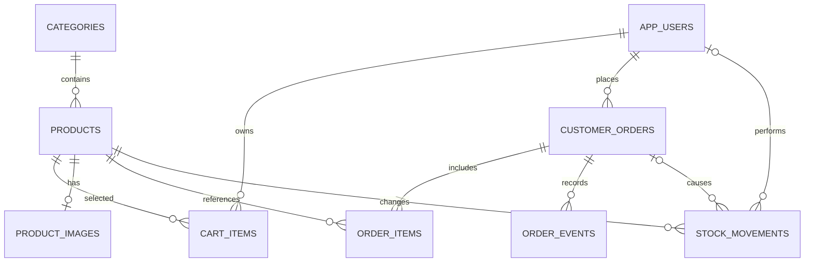

# Thiết kế cơ sở dữ liệu hiện hành — SuniCoffee 0.3

Một cửa hàng, một kho, hai vai trò CUSTOMER và ADMIN. Cấu trúc được tạo bởi V1/V2 và Java migration V3. Không sửa migration đã triển khai. H2 dùng cho demo/kiểm thử, MySQL là cơ sở dữ liệu mục tiêu.

## Sơ đồ quan hệ

`account_admin_guard` là bảng kỹ thuật chứa một dòng khóa phối hợp thay đổi quyền/trạng thái tài khoản. `flyway_schema_history` theo dõi phiên bản schema.

## Từ điển dữ liệu

| Bảng | Trường chính | Quy tắc |
| --- | --- | --- |
| app_users | id, full_name, email, password_hash, role, enabled, phone, address, auth_version, version | Email duy nhất; BCrypt; version chống sửa từ biểu mẫu cũ; auth_version thu hồi phiên |
| categories | id, code, name, description | Mã/tên duy nhất; chỉ xóa danh mục trống |
| products | id, version, sku, name, description, price, stock, sales_unit, active, category_id, has_image | Giá >0; stock >=0; SKU duy nhất; version phát hiện dữ liệu cũ |
| product_images | product_id, media_type, content | 0–1 ảnh/sản phẩm; JPG/PNG đã kiểm tra và mã hóa lại, tối đa 5 MB |
| cart_items | id, user_id, product_id, quantity | Unique user/product; số lượng 1–99; giỏ không giữ tồn |
| customer_orders | id, user_id, checkout_token, recipient_name, phone, address, note, status, total, created_at, completed_at | Token duy nhất; thông tin nhận hàng chụp lúc mua; total gồm phí |
| customer_orders (vận chuyển) | shipping_fee, carrier, tracking_code, shipped_at, returned_at, cod_settled_at | Phí >=0; hãng/mã tối đa 100 ký tự; ngày chưa xảy ra để NULL |
| order_items | id, order_id, product_id, product_name, sku, unit_price, quantity, restocked_quantity | Bản chụp tên/SKU/giá; số lượng nhận lại tồn 0..quantity, NULL nếu chưa nhận hoàn |
| stock_movements | id, product_id, actor_id, order_id, type, quantity_delta, balance_after, reason, request_token, created_at | Số dư >=0; delta !=0; request token duy nhất; unique order/product/type |
| order_events | id, order_id, status, actor, note, created_at | Nhật ký append-only qua ứng dụng; actor là bản chụp tên định danh; không dựng lịch sử trước nâng cấp |

Các kích thước chi tiết nằm trong migration. Tiền dùng DECIMAL và BigDecimal, không dùng float. Phí V1/V2 được đặt 0, không đổi tổng cũ. Ngày hoàn thành/đối soát/vận chuyển lịch sử không rõ không được tự gán.

## Giao dịch và tồn kho

Checkout khóa tài khoản, sau đó khóa/refresh sản phẩm theo ID tăng dần. Đơn, chi tiết, trừ tồn, SALE, sự kiện và xóa giỏ cùng transaction. Thiếu một dòng thì rollback tất cả. Gửi lại token của chính khách trả cùng đơn.

Hủy hoặc nhận hoàn khóa đơn trước và khóa sản phẩm theo ID tăng dần. Hủy hợp lệ dùng CANCEL_RETURN; nhận hàng hoàn dùng DELIVERY_RETURN cho số còn bán được. Mỗi loại hoàn theo đơn/sản phẩm chỉ xuất hiện một lần. Giao thất bại và chuyển hoàn không làm thay đổi tồn.

Sản phẩm có sẵn không được sửa tồn trên form sản phẩm: dùng RECEIPT/ISSUE có lý do. OPENING là số dư lúc tạo/nâng cấp, không phải lịch sử nhập trước đó.

## Trạng thái và báo cáo

Luồng đầy đủ và sơ đồ nằm trong [thiết kế nghiệp vụ 0.3](06-thiet-ke-va-nghiep-vu-v03.md). Doanh thu theo completed_at của COMPLETED và tiền hàng `total-shipping_fee`. Top nhóm theo product_id. COD được xác nhận riêng, không tự đối soát khi giao thành công.

Chỉ mục chính: product/category; order/user; order/status/created_at; order/status/completed_at; stock/created_at; event/order/id. Chưa có cam kết tải lớn; cần đo theo dữ liệu và môi trường triển khai thực tế.
