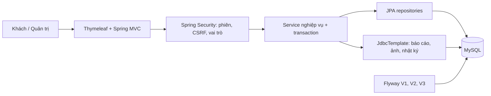
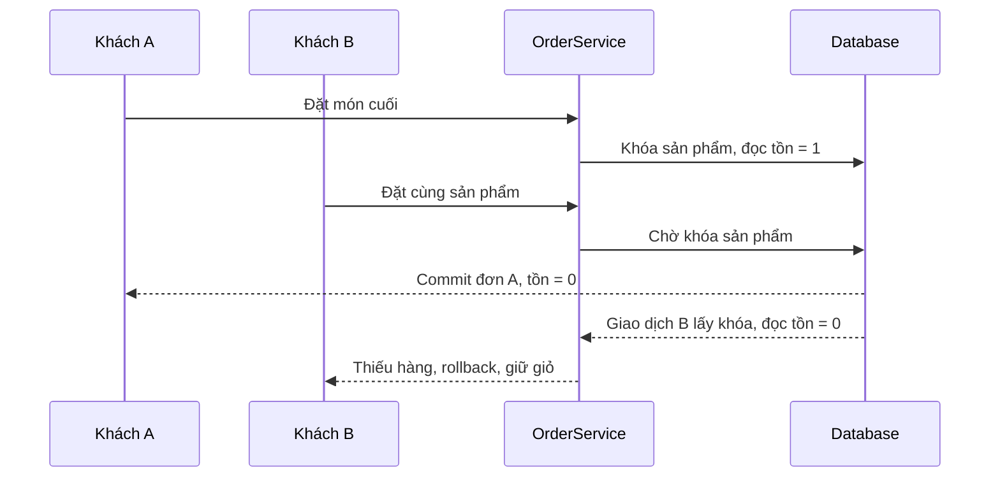
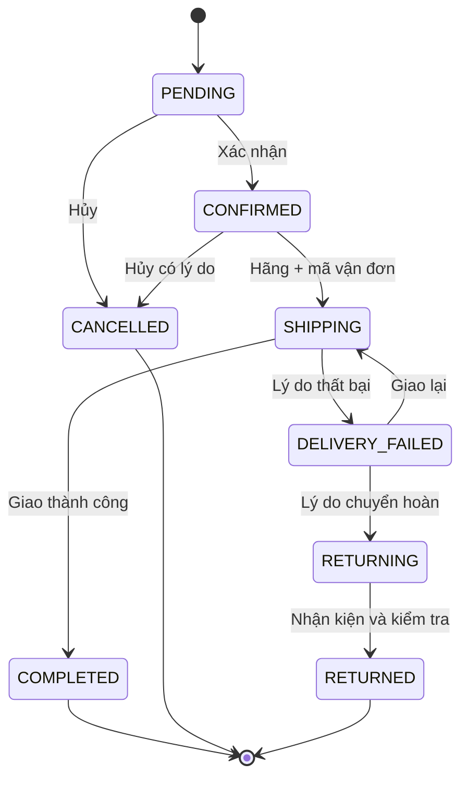
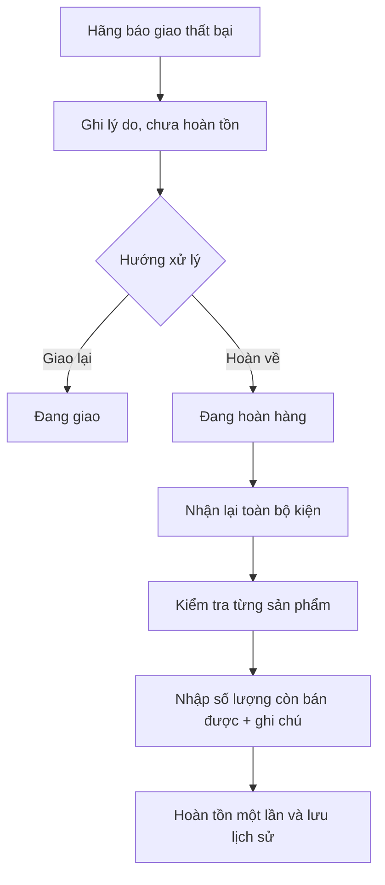

# Thiết kế và nghiệp vụ SuniCoffee 0.3

Ngày cập nhật: 06/10/2026. Phạm vi: phần mềm bán hàng và vận hành, không triển khai AI. Dữ liệu trình diễn là mô phỏng. Người dùng xác nhận phí giao hàng mặc định 0 VND, xử lý thủ công đơn chờ lâu và hoàn tồn theo số lượng còn bán được.

## Kiến trúc

H2 phục vụ demo và kiểm thử; MySQL là cơ sở dữ liệu mục tiêu. Một ứng dụng phục vụ một cửa hàng, một kho. Các request thay đổi dùng POST có CSRF. Mật khẩu băm BCrypt. Quyền quản trị được kiểm tra theo đường dẫn `/admin/**`; trạng thái tài khoản được kiểm tra lại trên mỗi yêu cầu. Giới hạn 20 POST đăng nhập/phút/IP trên một tiến trình; trả 429 và Retry-After khi vượt ngưỡng. Bộ giới hạn không dùng header do khách tự gửi để xác định IP, chưa thay thế rate limiting phân tán.

## Tác nhân và use case

| Mã | Tác nhân | Use case | Điều kiện / kết quả |
| --- | --- | --- | --- |
| UC01 | Khách chưa đăng nhập | Xem, tìm sản phẩm; đăng ký/đăng nhập | Chỉ xem sản phẩm đang bán; đăng ký luôn là CUSTOMER |
| UC02 | Khách | Thêm/sửa/xóa giỏ | Số lượng mỗi dòng 1–99; giỏ chưa giữ hàng |
| UC03 | Khách | Đặt COD | Giỏ đủ hàng, token phiên hợp lệ; tạo đơn, trừ tồn, nhật ký và xóa giỏ nguyên tử |
| UC04 | Khách | Xem đơn, hủy đơn | Chỉ xem đơn của mình; chỉ hủy PENDING; hoàn tồn một lần |
| UC05 | Quản trị | Quản lý sản phẩm/danh mục/ảnh | Sản phẩm cũ đổi tồn qua phiếu kho; ngừng bán giữ lịch sử |
| UC06 | Quản trị | Xác nhận và bàn giao vận chuyển | Đơn hợp lệ; bàn giao bắt buộc hãng và mã vận đơn |
| UC07 | Quản trị | Giao thất bại, giao lại, chuyển hoàn | Bắt buộc lý do thất bại/chuyển hoàn; chưa hoàn tồn |
| UC08 | Quản trị | Nhận hàng hoàn | Đã nhận toàn bộ kiện; nhập số còn bán được theo từng dòng và kết quả kiểm tra |
| UC09 | Quản trị | Đối soát COD | Chỉ đơn COMPLETED; xác nhận đã nhận đủ tổng tiền đơn; không ghi lặp |
| UC10 | Quản trị | Nhập/xuất kho | Số dư không âm; có lý do, người thao tác, token chống lặp |
| UC11 | Quản trị | Tìm/lọc đơn và xử lý đơn chờ lâu | Theo mã SUNI/id, tên người nhận/email, trạng thái, ngày đặt, chờ quá 48 giờ |
| UC12 | Quản trị | Báo cáo doanh thu | Theo ngày hoàn thành tại Việt Nam; tiền hàng không gồm phí vận chuyển |
| UC13 | Người dùng / Quản trị | Hồ sơ, mật khẩu / quản lý tài khoản | Giữ thông tin đơn cũ; thu hồi phiên khi đổi mật khẩu/quyền/trạng thái |

## UC03 — Đặt hàng

Tiền điều kiện: đăng nhập, giỏ không rỗng, thông tin nhận hàng hợp lệ. Khi mở trang thanh toán, tạo token riêng cho tab và lưu trong tập tối đa 20 token của phiên. Mở tab khác không thay token cũ; token cũ nhất hết hiệu lực khi vượt giới hạn. Token đã dùng vẫn cho gửi lại cùng đơn khi còn trong tập, không tạo thêm đơn.

Luồng chính: khóa tài khoản → kiểm tra đơn theo token → đọc giỏ theo ID sản phẩm → khóa ghi và refresh từng sản phẩm → kiểm tra active/tồn → tạo chi tiết bản chụp giá/tên/SKU → trừ tồn → cộng phí → lưu đơn PENDING → ghi nhật ký và SALE → xóa giỏ → commit.

Ngoại lệ: token sai trả lỗi biểu mẫu; thiếu hàng hoàn tác toàn bộ; lỗi khóa trả thông báo thử lại, không tự retry vô hạn. Hai khách tranh món cuối: giao dịch lấy khóa và commit trước được mua, giao dịch sau đọc tồn mới. Thời điểm bấm nút không bảo đảm thứ tự lấy khóa.

## UC06–09 — Vận chuyển và COD

Mỗi đơn một chuyến gửi/mã vận đơn hiện hành. Cho phép giao lại sau thất bại. Hủy trước bàn giao hoàn toàn bộ tồn; đã bàn giao không dùng thao tác hủy để tự cộng tồn. Ngày bàn giao là lần đầu; từng lần chuyển trạng thái có nhật ký riêng.

Khi nhận hoàn, mọi dòng phải có số lượng còn bán được từ 0 đến số đã mua. Phần chênh lệch là hàng không nhập lại tồn bán; kết quả kiểm tra phải ghi rõ lý do. Không hỗ trợ nhận kiện từng phần hoặc đổi trả sau giao thành công. Một dòng sai làm rollback toàn bộ nhận hoàn. Khóa đơn ngăn hai người hoàn kho cùng một đơn hai lần; nhật ký kho có ràng buộc duy nhất order/product/type.

COD có `cod_settled_at` riêng. COMPLETED không tự đặt ngày nhận tiền. Bản này xác nhận nhận đủ tiền COD thủ công, chưa quản lý các khoản đối soát một phần, phí hãng khấu trừ hoặc kết nối thu hộ.

## Phí, doanh thu và đơn chờ

`SHIPPING_FEE` là phí cố định VND nguyên, mặc định 0; giới hạn cấu hình 0–10.000.000. Phí hiển thị trước khi xác nhận và chụp vào đơn. Tổng thanh toán = tiền hàng + phí. Thay cấu hình không thay đơn cũ. Các đơn V1/V2 giữ phí 0 và tổng cũ.

Doanh thu = tổng tiền hàng của đơn COMPLETED trong kỳ, không gồm phí vận chuyển. Top 10 nhóm theo product_id; tên/SKU hiển thị từ dòng mua có ID mới nhất trong kỳ, doanh thu cộng giá lịch sử từng dòng. Đổi tên không tách thứ hạng. Chưa tính lợi nhuận. Ngày hoàn thành cũ không rõ vẫn để trống và báo riêng.

`PENDING_REMINDER_HOURS` mặc định 48 giờ chỉ dùng để lọc nhắc xử lý. Admin liên hệ rồi xác nhận hoặc hủy có lý do. Không tự hủy COD, không tự gửi thông báo ra ngoài.

## Quy tắc nhật ký

`order_events` ghi thời điểm Việt Nam, trạng thái sau thao tác, người thực hiện và ghi chú. Bao gồm đặt, xác nhận, bàn giao, giao lại, thất bại, chuyển hoàn, nhận hoàn, hủy và đối soát. Khách chỉ xem lịch sử đơn của mình; email người thao tác chỉ hiện với admin. Các sự kiện trước V3 không được dựng lại thiếu căn cứ.

## Giới hạn đã chốt

Không AI, không API hãng vận chuyển, không thanh toán online, không chia kiện/giao từng phần, không tự đối soát hoặc tính lợi nhuận. Dữ liệu hiện tại là mẫu; thông tin cửa hàng thật, mẫu báo cáo của khoa và xác nhận khảo sát chưa được cung cấp.
